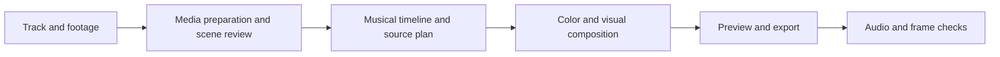

# Moorla Kaggle

A macOS application for building music videos from multiple sources, with scene review, guide-based color matching and Metal compositing.

I brought an earlier notebook workflow into an editor that combines footage preparation, musical timing and image controls. Version 1.1 includes project save/load, scene thumbnails, source intervals, a color comparison, an image asset gallery and video export with a verification report.

## Workflow

1. Add a track and source videos.
2. Review scenes and choose usable intervals.
3. Match material to a guide clip and compare the color treatment.
4. Adjust distortion, source memories, short musical stutters and optional generated image assets.
5. Preview an excerpt and export the result.

The source mode advances through footage and schedules shot changes at the end of a usable interval. Scene preparation and image banks are cached for reuse. HDR and variable frame rate material are prepared as separate working copies, preserving the originals.

Quick previews support iteration; export-state previews reconstruct the composition at final quality. The local rendering workflow combines Metal image processing with VideoToolbox encoding.

## Verification

The shared Python suite completed 117 tests on 27 November 2026: 114 passed, with 3 device-specific checks skipped. CPU coverage includes source boundaries, preview timing, cache identity, media decoding, audio sample selection and control behavior. The version 1.1 app binary matched its saved release manifest. [Validation](validation.md).

**Stack:** Swift/SwiftUI, Python, Metal/PyTorch, OpenCV, SceneDetect, FFmpeg and VideoToolbox.
