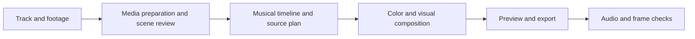

# Moorla Kaggle

A native macOS application developed from my music-video notebook workflow, with multi-source editing, scene review, guide-based color matching and Metal composition.

The port spans the SwiftUI interface, Python orchestration, source preparation, editing plan, GPU processing and export verification. Version 1.1 brings those stages into one project workflow: add footage, review scenes, choose usable intervals, compare color, inspect image assets and render a selected part of the track.

## Porting behavior across runtimes

The original notebook mixed musical analysis, source playback and image effects. I separated the musical score, the editing plan and the compositor, with explicit inputs between them. Reference-based regressions compare selected scheduling and asset behavior on controlled inputs; the native app then adds multiple sources, source windows and reusable preparation.

The interface carries treatment, distortion, source-memory, musical-stutter and image-asset controls into the render configuration. Tests compare neutral and modified settings, disabled paths and the frames in which an effect is active. This checks the behavior behind a control as well as the configuration it saves.

## Keeping three clocks aligned

A render connects song frames, source-video frames and audio samples. The editing plan records the source frame assigned to each output frame, and the reader checks that assignment during rendering. Forward playback consumes selected footage and changes shot at source exhaustion; brief musical stutters remain a separate control. The plan records source reuse and coverage.

An excerpt keeps its position in the parent musical timeline. A faithful preview replays the preceding composition state at export quality before writing the requested interval. The fast draft uses reduced resolution, bounded warmup and existing image assets. Both modes share the planned source timing.

## Media preparation and reuse

HDR and variable frame rate clips are normalized into separate working copies. Frame timing follows presentation timestamps, and indexing, matching and rendering refer to the prepared media consistently.

Preparation and color caches are bound to the relevant source identity, selected intervals and tool/settings context. Changing a source or its selected material causes the affected analysis to be rebuilt. Generated image banks are prepared separately, can be inspected in a gallery and can be reused or disabled for a render.

## Verifying the output

The export path checks decoded audio against the requested source sample interval, including sample count, channel layout, sample rate and track origin. The render trace records source-frame correspondence for frames passed to the encoder, and the report records the image bank and color treatment used. The original media is preserved.

On **27 November 2026**, the shared Python suite completed **117 tests: 114 passed, 3 device-specific checks skipped, zero failures**. CPU coverage includes timing, source boundaries, cache identity, decoded media, audio selection and control behavior. The local version 1.1 binary matched its saved release manifest. [Validation](validation.md).

**Stack:** Swift/SwiftUI, Python, Metal/PyTorch, OpenCV, SceneDetect, FFmpeg and VideoToolbox.
