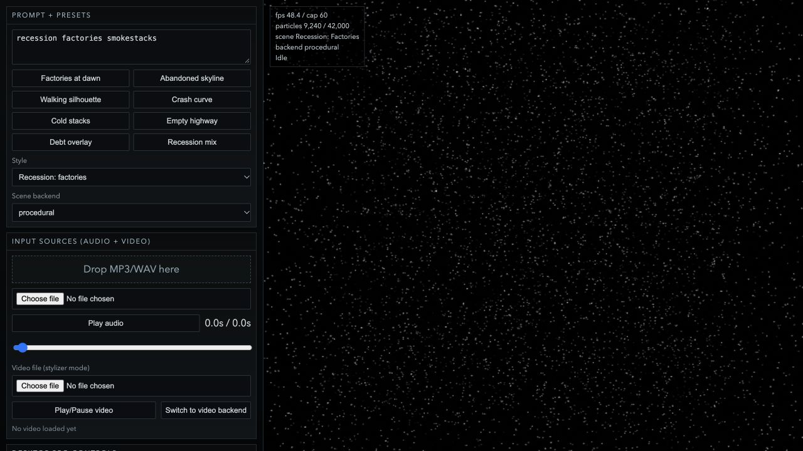

# Recession Visual Synth

*Actual browser interface running the local procedural scene, without external media.*

A visual instrument for monochrome particle scenes, audio-reactive motion and point-based video treatment. I built the prototype around a React/TypeScript interface, a Three.js WebGL renderer and a Tauri desktop wrapper.

## A configurable processing chain

The application separates audio input and analysis, scene construction, point sampling, particle motion, image treatment and output. A configurable chain controls stage order and activation; the engine carries the resulting audio and scene state between updates.

Procedural presets, prompt-driven template selection and video input feed the scene side of that pipeline. A sequencer changes scenes through saved clips, while a shared seed supports repeatable scene choices and preset configurations. Settings are serialized as a project patch for save/load.

## Rendering and interaction

Particle count, render scale and frame-rate caps are independent controls. Adaptive quality changes the active particle budget within the selected bounds using the observed render cadence. The renderer keeps the canvas layout separate from its internal rendering resolution, so quality adjustments preserve the intended framing.

Audio features drive configurable visual responses, while the interface exposes the current engine state and meters. Image treatment includes bloom, temporal trails and CRT-style processing. A browser capture path exports PNG frames; preset JSON preserves the configuration used to construct the scene.

## Browser and desktop boundary

The rendering engine is shared between the web interface and desktop wrapper. A narrow native bridge provides file export, window controls and platform information when running through Tauri. This keeps native actions separate from scene generation and rendering.

The TypeScript project build and Vite production bundle completed successfully in an isolated copy on **27 November 2026**. The interface image above was captured from the local procedural run. [Validation](validation.md).

**Stack:** React, TypeScript, Three.js, Web Audio, Vite and Tauri/Rust.
